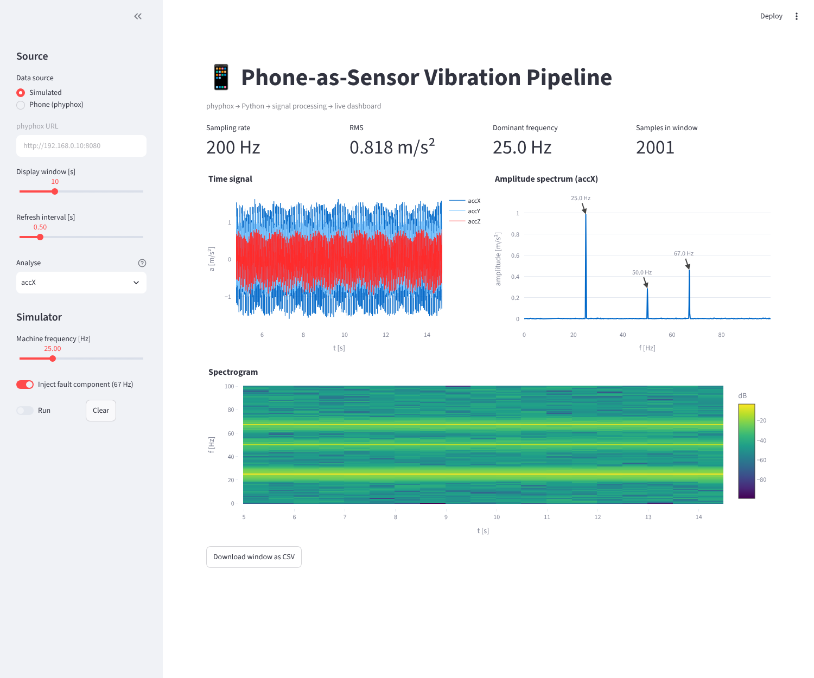

# 📱 Phone-as-Sensor Vibration Pipeline

Turns a smartphone into a wireless vibration sensor. Accelerometer data is streamed over Wi-Fi from the [phyphox](https://phyphox.org) app into Python. It is then resampled, analysed with FFT and STFT, and shown live in a Streamlit dashboard. The pipeline mirrors a basic condition-monitoring chain: **sensor → transmission → signal processing → visualisation**.


*Simulated mode: a 25 Hz "machine" with its 2nd harmonic, plus an injected 67 Hz fault component that shows up clearly in the spectrum and spectrogram.*

## What it does

- **Live acquisition** from a phone via the phyphox remote-access REST API, with incremental polling so only new samples are fetched.
- **Resampling onto a uniform grid.** Phone sensors don't sample at a perfectly constant rate, and the FFT assumes uniform sampling.
- **Signal analysis:** RMS (DC/gravity removed), a Hann-windowed amplitude spectrum scaled so that peak height ≈ sinusoid amplitude, peak detection, and a spectrogram.
- **Simulated source** with an adjustable machine frequency and a toggleable fault component. The whole pipeline can be tested without a phone.
- **CSV export** from the dashboard, plus a command-line recorder.

## Quick start

```bash
git clone https://github.com/chandanarashwathappa/phone-sensor-pipeline.git
cd phone-sensor-pipeline
python -m venv venv
.\venv\Scripts\Activate.ps1        # Windows
# source venv/bin/activate         # macOS / Linux
pip install -r requirements.txt

streamlit run app.py               # choose "Simulated" to try it without a phone
```

## Using a real phone

1. Install **phyphox** (Android or iOS). Open the **"Acceleration (without g)"** experiment.
2. Tap the **⋮ menu → Allow remote access**. phyphox shows a URL like `http://192.168.0.23:8080`.
3. Put the phone and laptop **on the same Wi-Fi**. University networks such as eduroam often block device-to-device traffic. A phone hotspot works.
4. In the dashboard, select **Phone (phyphox)**, paste the URL, and switch on **Run**.

Record to a file without the dashboard:

```bash
python record.py --url http://192.168.0.23:8080 --seconds 30 --out vibration.csv
python record.py --sim --seconds 10        # simulator
```

**Experiment ideas:** place the phone on a running washing machine, a desk fan, or a laptop with its fan under load. Watch the dominant frequency change with the speed setting.

## Design decisions

- **Same interface for both sources.** `PhyphoxSource` and `SimulatedSource` both return `Samples(t, channels)`, so processing and the UI don't know or care where the data comes from.
- **Resample before the FFT.** Timestamps are irregular, so the sampling rate is estimated from the median sample interval, which is robust to jitter. The signal is then linearly interpolated onto a uniform grid.
- **Single axes by default, not magnitude.** √(x²+y²+z²) is orientation-independent, but it is nonlinear. Without gravity, it creates spurious components at 2× the vibration frequency. Magnitude is available, but it isn't the default.
- **Tested against a fake phyphox server.** The HTTP client is tested against a local server that returns phyphox-format JSON. The processing functions are tested against signals with known frequency and amplitude.

## Tests

```bash
python -m pytest -q
```

## Project structure

```
phone-sensor-pipeline/
├── app.py                  # Streamlit live dashboard
├── record.py               # CLI recorder → CSV
├── sensor_sources.py       # phyphox REST client + simulator
├── processing.py           # resampling, RMS, FFT, peaks, spectrogram
├── tests/                  # unit tests incl. fake phyphox server
└── requirements.txt
```

## Limitations and next steps

- Phone accelerometers typically sample at 100–500 Hz, so only vibrations below about half that rate (the Nyquist limit) are visible.
- The phone's coupling to the surface affects the measured amplitude. Results are relative, not calibrated.
- **Next:** add the microphone as a second channel (acoustic data), automatic alarm thresholds on band energy, and an OPC UA server that exposes the measured values to industrial clients.

## Author

**Chandana Rajaputhrapalya Ashwathappa**
M.Sc. Electrical Engineering & IT, Otto von Guericke University Magdeburg
